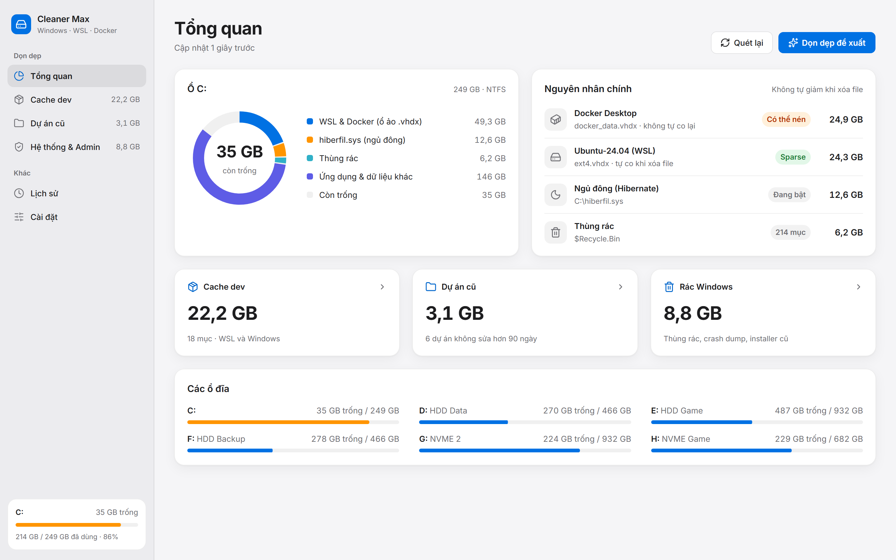
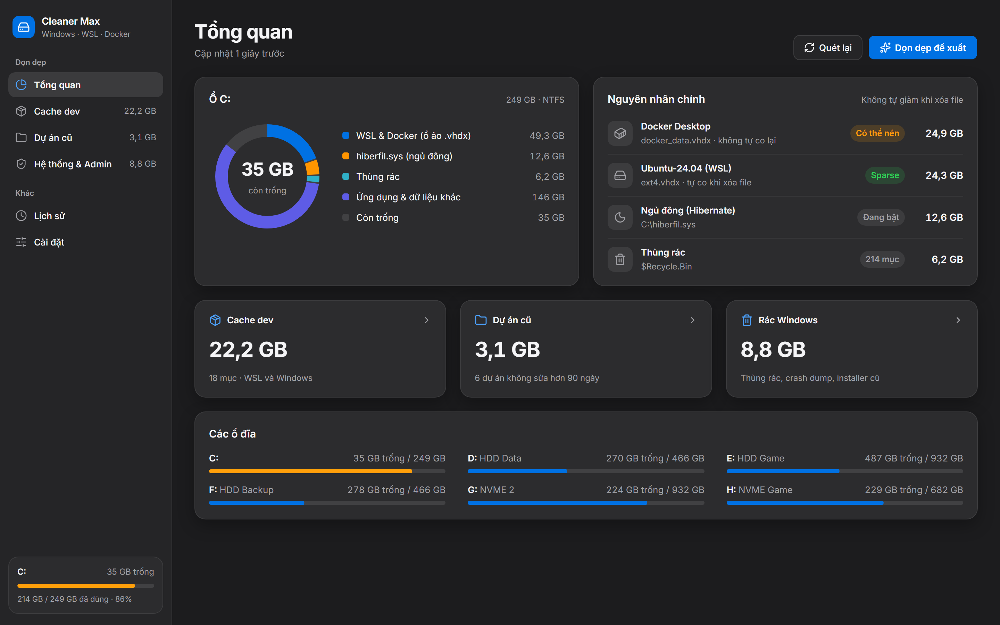
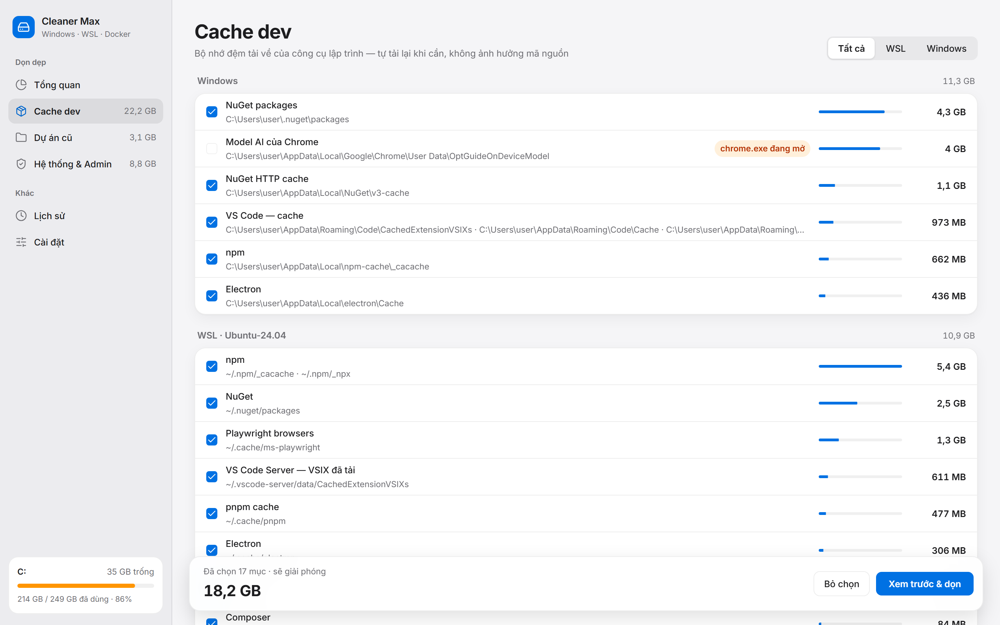
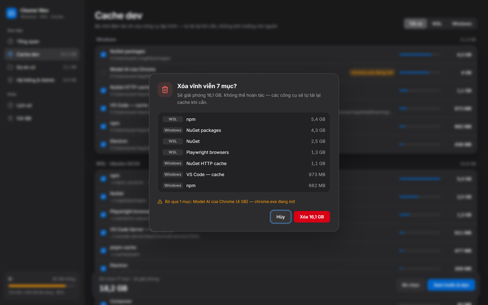
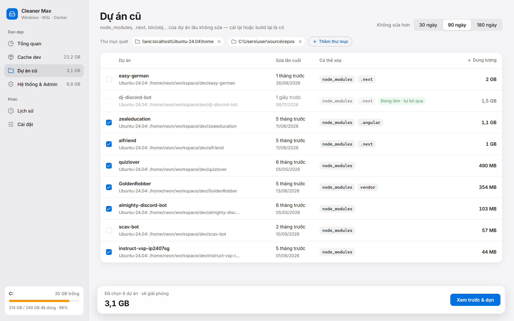
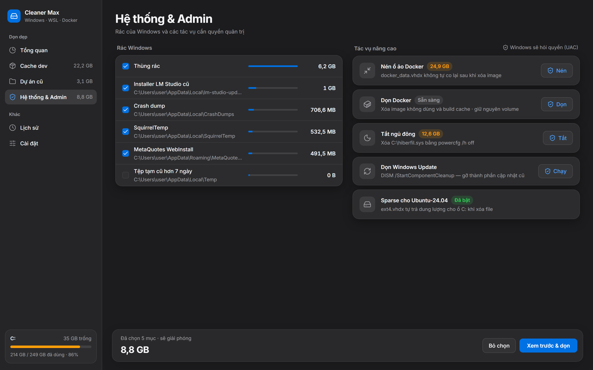
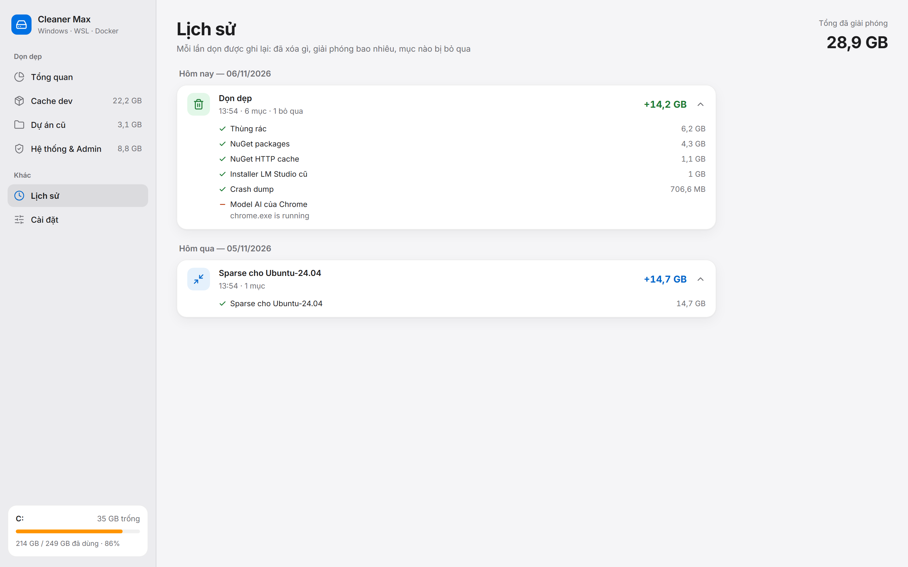
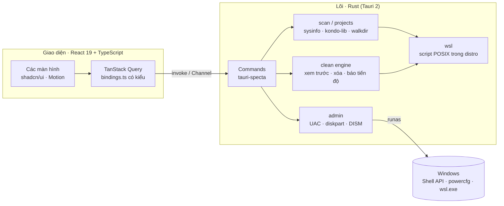

<p align="center">
  
</p>

<h1 align="center">Cleaner Max</h1>

<p align="center">
  Tìm và giải phóng dung lượng ổ C: bị chiếm bởi WSL, Docker, cache của công cụ lập trình<br />
  và build artifact của những dự án bạn đã lâu không đụng tới.
</p>

<p align="center">
  <a href="https://github.com/letrucdev/cleaner-max/actions/workflows/ci.yml"></a>
  <a href="https://github.com/letrucdev/cleaner-max/releases/latest"></a>
  
  
  
  
  
  
</p>

<p align="center">
  <a href="#tính-năng">Tính năng</a> ·
  <a href="#ảnh-chụp-màn-hình">Ảnh chụp</a> ·
  <a href="#cài-đặt">Cài đặt</a> ·
  <a href="#build-từ-mã-nguồn">Build</a> ·
  <a href="#kiến-trúc">Kiến trúc</a> ·
  <a href="#lộ-trình">Lộ trình</a>
</p>

<p align="center">
  
</p>

## Vì sao có Cleaner Max

Trên máy dùng để lập trình, ổ C: thường đầy dần mà không rõ lý do. Các công cụ dọn rác quen thuộc không tìm ra thủ phạm, vì phần lớn dung lượng nằm ở những chỗ chúng không nhìn tới:

- **Ổ ảo của WSL và Docker** (`ext4.vhdx`, `docker_data.vhdx`) chỉ phình ra mà không bao giờ tự co lại, kể cả khi bạn đã xóa file bên trong.
- **Cache của công cụ lập trình** (npm, pnpm, NuGet, pip, uv, Playwright, VS Code Server…) nằm rải rác ở cả Windows lẫn bên trong từng distro WSL.
- **Build artifact** (`node_modules`, `.next`, `bin/obj`, `target`…) của những dự án đã vài tháng không mở.

Cleaner Max được xây dựng từ một lần dọn dẹp thực tế: một ổ C: 250 GB từ **9,6 GB trống lên 35 GB trống**. Mọi bước đã làm tay trong lần đó trở thành một tính năng có kiểm soát, có xem trước và có lịch sử.

## Tính năng

| | |
|---|---|
| **Tổng quan ổ đĩa** | Biểu đồ phân bổ ổ C:, chỉ ra nguyên nhân chính (ổ ảo WSL/Docker và trạng thái sparse, `hiberfil.sys`, thùng rác) cùng dung lượng có thể dọn ngay. |
| **Cache dev** | 25 loại cache (11 trên Windows, 14 trong mỗi distro WSL), nhóm theo nền tảng. Mục nào bị khóa vì ứng dụng liên quan đang mở thì tự bỏ qua. |
| **Dự án cũ** | Quét thư mục dự án (ổ Windows và `\\wsl.localhost\…`), tìm build artifact theo loại dự án, chọn sẵn các dự án không sửa quá 30/90/180 ngày. Dự án đang làm bị khóa, không thể chọn. |
| **Rác Windows** | Thùng rác (gọi thẳng Shell API), crash dump, file tạm cũ hơn 7 ngày, installer cập nhật bị bỏ lại. |
| **Tác vụ nâng cao** | Nén ổ ảo `.vhdx`, bật sparse cho WSL, dọn image/build cache của Docker, tắt ngủ đông, dọn Windows Update (DISM). Mỗi tác vụ chỉ hỏi quyền UAC một lần. |
| **Lịch sử** | Ghi lại mỗi lần dọn: đã xóa gì, giải phóng bao nhiêu, mục nào bị bỏ qua và vì sao. Lưu trên máy, không gửi đi đâu. |
| **Giao diện** | Thiết kế theo Apple Human Interface Guidelines, nền Mica trên Windows 11, sáng/tối/theo hệ thống, tiếng Việt và tiếng Anh, chuyển động spring tôn trọng cài đặt giảm chuyển động. |

### An toàn là mặc định

- **Luôn xem trước rồi mới xóa.** Danh sách xác nhận liệt kê chính xác từng mục và dung lượng của nó, được đo bằng đúng hàm mà lệnh xóa sẽ dùng.
- **Backend không tin frontend.** Mỗi mục được tra lại từ registry nội bộ hoặc từ kết quả quét gần nhất. Đường dẫn ổ ảo phải trùng với ổ mà máy thực sự có. Thư mục dự án chỉ bị xóa khi tên nằm trong danh sách artifact hợp lệ.
- **Không dừng giữa chừng.** File đang bị khóa được bỏ qua và báo lại, phần còn lại vẫn được dọn.
- **Không bao giờ treo.** Mọi tiến trình con chạy không có cửa sổ, không có stdin, và có giới hạn thời gian.
- **Tôn trọng công cụ gốc.** Store của pnpm chỉ được `prune` (vì dùng hardlink chung với các dự án đang làm). Volume của Docker không bao giờ bị động tới.

## Ảnh chụp màn hình

<table>
  <tr>
    <td width="50%"></td>
    <td width="50%"></td>
  </tr>
  <tr>
    <td align="center"><sub>Tổng quan, giao diện tối</sub></td>
    <td align="center"><sub>Cache dev trên Windows và WSL</sub></td>
  </tr>
  <tr>
    <td width="50%"></td>
    <td width="50%"></td>
  </tr>
  <tr>
    <td align="center"><sub>Xác nhận trước khi xóa, kèm các mục bị bỏ qua</sub></td>
    <td align="center"><sub>Build artifact của dự án lâu không sửa</sub></td>
  </tr>
  <tr>
    <td width="50%"></td>
    <td width="50%"></td>
  </tr>
  <tr>
    <td align="center"><sub>Rác Windows và tác vụ cần quyền quản trị</sub></td>
    <td align="center"><sub>Lịch sử từng lần dọn</sub></td>
  </tr>
</table>

<sub>Ảnh chụp dùng dữ liệu mẫu, được tạo bằng <code>scripts/screenshots.ps1</code>.</sub>

## Cài đặt

**Yêu cầu hệ thống**

- Windows 10 (1809 trở lên) hoặc Windows 11. Nền Mica chỉ có trên Windows 11.
- Microsoft Edge WebView2 Runtime (có sẵn trên Windows 11; bộ cài tự tải nếu thiếu).
- Không bắt buộc: WSL 2 và Docker Desktop. Các tính năng tương ứng tự ẩn hoặc báo trạng thái nếu không có.

**Bộ cài**

Tải bản mới nhất ở trang [Releases](https://github.com/letrucdev/cleaner-max/releases/latest). Mỗi bản có hai loại bộ cài cho Windows x64, do GitHub Actions build từ tag `v*`:

| Định dạng | Tệp | Kích thước |
|---|---|---|
| NSIS | `Cleaner Max_0.1.0_x64-setup.exe` | khoảng 2,5 MB |
| MSI | `Cleaner Max_0.1.0_x64_en-US.msi` | khoảng 3,5 MB |

> Bộ cài hiện chưa được ký số, nên Windows SmartScreen có thể hiện cảnh báo khi chạy lần đầu.

## Build từ mã nguồn

**Chuẩn bị**

- [Node.js](https://nodejs.org/) 20 trở lên
- [Rust](https://rustup.rs/) bản stable (toolchain MSVC)
- [Visual Studio Build Tools 2022](https://visualstudio.microsoft.com/visual-cpp-build-tools/) với workload "Desktop development with C++" (MSVC + Windows SDK)

**Các lệnh thường dùng**

```powershell
npm install

npm run tauri dev      # chạy ứng dụng ở chế độ phát triển
npm run tauri build    # build bản release và tạo bộ cài NSIS + MSI

npm run dev            # chỉ chạy giao diện trong trình duyệt, dùng dữ liệu mẫu (mock IPC)
npm run lint:tw        # kiểm tra class Tailwind chưa ở dạng chuẩn

cd src-tauri
cargo test             # unit test (thư mục tạm, không đụng dữ liệu thật)
cargo test smoke -- --ignored --nocapture   # quét thử máy thật, chỉ đọc
```

Bộ cài được tạo trong `src-tauri/target/release/bundle/`. Kiểu TypeScript cho các command được tự sinh vào `src/lib/bindings.ts` mỗi lần chạy debug hoặc chạy `cargo test export_bindings`.

## Kiến trúc



```
src/                    Giao diện
  features/             Mỗi màn hình một thư mục (overview, caches, projects, system, history, settings)
  components/app/       Sidebar, hộp thoại dọn, thanh chọn, segmented control
  lib/                  API có kiểu, định dạng (date-fns, filesize), selector, preset chuyển động
  i18n/                 Tiếng Việt và tiếng Anh
  mocks/                Dữ liệu mẫu để phát triển giao diện trong trình duyệt
src-tauri/src/          Lõi Rust
  registry.rs           Danh sách khai báo các mục có thể dọn
  scan.rs, projects.rs  Quét ổ đĩa, ổ ảo, cache và dự án
  clean.rs, fsutil.rs   Engine xem trước/xóa, bỏ qua file bị khóa
  admin.rs              Tác vụ cần quyền quản trị
  wsl.rs, proc.rs       Làm việc với WSL, chạy tiến trình con có timeout
docs/                   Kế hoạch, thiết kế, ghi chú bàn giao từng phiên
```

### Công nghệ

| Lớp | Thư viện |
|---|---|
| Ứng dụng | Tauri 2, tauri-specta (binding TypeScript có kiểu) |
| Giao diện | React 19, Vite, Tailwind CSS 4, shadcn/ui (Radix), Motion |
| Dữ liệu và trạng thái | TanStack Query, TanStack Table, Zustand |
| Định dạng và i18n | i18next, date-fns, filesize, lodash-es |
| Lõi Rust | sysinfo, kondo-lib, walkdir, rayon, windows, winreg, runas, window-vibrancy |

## Những gì Cleaner Max có thể dọn

<details>
<summary><b>Cache của công cụ lập trình</b></summary>

| Nền tảng | Mục |
|---|---|
| Windows | npm, NuGet packages, NuGet HTTP cache, pip, uv, Yarn, pnpm cache, Playwright browsers, Electron, VS Code (VSIX, Cache, CachedData), model AI của Chrome |
| WSL (từng distro) | npm, pnpm cache, pnpm store (`prune`), Yarn, NuGet, Playwright, VS Code Server VSIX, Electron, node-gyp, TypeScript, uv, pip, Composer, Go build cache |

</details>

<details>
<summary><b>Build artifact theo loại dự án</b></summary>

| Loại | Thư mục |
|---|---|
| Node | `node_modules`, `.next`, `.nuxt`, `.svelte-kit`, `.parcel-cache`, `.turbo`, `.angular` |
| .NET | `bin`, `obj` |
| Rust | `target` |
| Python | `.venv`, `__pycache__`, `.pytest_cache`, `.mypy_cache`, `.ruff_cache`, `.tox` |
| PHP (Composer) | `vendor` |

`dist` và `build` không bao giờ bị coi là artifact, vì một số dự án commit chúng vào kho mã.

</details>

<details>
<summary><b>Tác vụ nâng cao</b></summary>

| Tác vụ | Thực hiện | Cần UAC |
|---|---|---|
| Nén ổ ảo | `wsl --shutdown`, rồi `diskpart` (attach readonly, compact, detach) | Có |
| Bật sparse cho WSL | `wsl --manage <distro> --set-sparse true` | Có |
| Dọn Docker | `docker image prune -a`, `docker builder prune -a` (giữ volume) | Không |
| Tắt ngủ đông | `powercfg /h off` | Có |
| Dọn Windows Update | `DISM /Online /Cleanup-Image /StartComponentCleanup` | Có |

</details>

## Lộ trình

- [ ] Ký số bộ cài và cập nhật tự động
- [ ] Nhắc khi ổ C: xuống dưới một ngưỡng dung lượng
- [ ] Đo trước dung lượng cho các mục chỉ biết sau khi chạy (pnpm prune)
- [ ] Thêm cache cho Gradle, Maven, Cargo registry, Go modules

## Tác giả

Phát triển bởi **letrucdev**.

## Giấy phép

Chưa chọn giấy phép. Cho đến khi có, mọi quyền đối với mã nguồn thuộc về tác giả.
